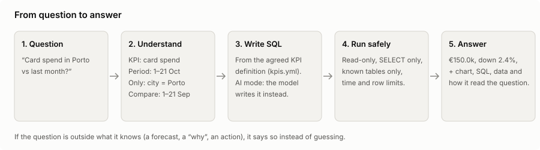
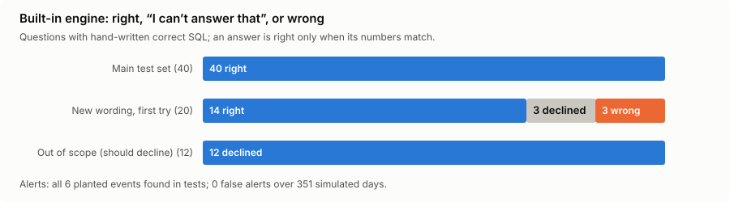
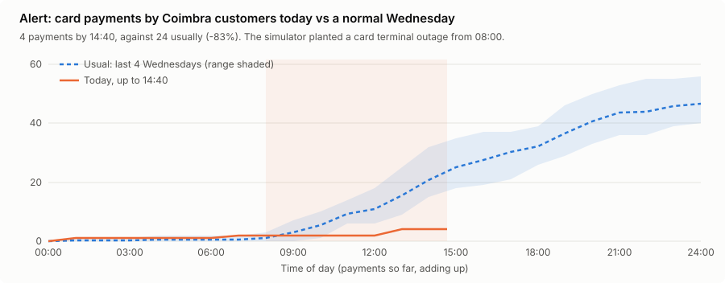

# 🏦 Bank KPI Assistant: talk with your database

[](https://github.com/saeedm31/bank-kpi-assistant/actions/workflows/tests.yml)
[](https://sh-bank-kpi-assistant.streamlit.app)

**Ask a bank's data a question in plain English and get the answer in seconds, with the number, a chart and
the working.** The assistant turns the question into SQL, runs it safely on live data and explains the result.

**▶ Try it: [sh-bank-kpi-assistant.streamlit.app](https://sh-bank-kpi-assistant.streamlit.app)** (no key needed)

```
You:        Card spend in Porto vs last month
Assistant:  Card spend for Porto this month so far is €150.0k, down 2.4% on the same days
            last month (1 Sep – 21 Sep 2026) (€153.7k).
            [chart]  [SQL]  [data]  [how I read it: KPI = card spend, period 1–21 Oct, city = Porto]

You:        Late payments on personal loans by region
Assistant:  Algarve has the highest late loan rate (30+ days) for Personal loan today (30.0%);
            Norte the lowest (4.44%).

You:        Why did card spend fall in Coimbra?
Assistant:  This question needs a custom query that the built-in engine doesn't write
            (I couldn't place: why). Try a saved example, or switch on AI mode.
```

## The problem

Managers wait days for a simple number ("deposits in the Algarve vs last year?") because only analysts can write
the SQL. Generic "chat with your database" tools answer fast but can't be trusted: two people asking the same
question get different numbers, and nobody can see how the answer was made.

## What this demo does about it

| | |
|---|---|
| **One meaning per KPI** | Every number (card spend, NPL ratio, active customers…) is defined once in [`kpis.yml`](bank_assistant/kpis.yml). Every answer uses that definition, so the same question always gives the same number. |
| **Shows its work** | Each answer comes with the SQL, the data, a chart and *how it read the question* (KPI, period, filters, comparison). Anyone can check it. |
| **Safe by design** | Read-only connection, SELECT only, known tables only (an SQLite authorizer blocks writes, `PRAGMA`, `ATTACH`, extensions), a time limit and a row limit. |
| **Knows its limits** | Forecasts, "why" questions, requests to change data and unknown topics get "I can't answer that", not a guess. |
| **Live data** | New payments arrive every minute; "today", "last 24 hours" and "this week so far" are real. |
| **Alerts before you ask** | Each branch is compared with the same weekday and hours of the last four weeks. Big, unlikely changes are flagged, with a "show me" chart. |
| **Two engines** | A **built-in engine** (free, instant, no AI model) for KPI questions, and an **AI mode** with your own key (Claude, OpenAI or any OpenAI-compatible server such as Ollama) for anything else. Six **saved examples** show harder questions with hand-written SQL. |



## Results



- **Main test set:** 40 of 40 questions right; 8 of 8 out-of-scope questions declined. An answer counts as right
  only when its numbers match hand-written SQL ([`eval/questions.yml`](eval/questions.yml)).
- **New wording, first try:** 20 questions written in advance and never used for tuning, scored once
  ([`eval/holdout2.yml`](eval/holdout2.yml), [result](reports/eval_unseen_first_run.json)): **14 right, 3 "I can't
  answer that", 3 wrong**. The wrong ones were visible in *how I read it* (for example, "restaurant" not taken as a
  filter). They have since been fixed, so that set no longer counts as unseen.
- **AI mode** can be scored on the same questions with your key: `python evaluate.py --ai openai`.



- **Alerts:** in tests, all 6 events the simulator planted were found (a card terminal outage, a burst of large
  transfers, a rush on ATMs), with **0 false alerts over 351 simulated days**.

## The data

A simulated Portuguese retail bank, so the demo can be shared freely and runs "live":

- 8 branches (Porto, Braga, Aveiro, Coimbra, Lisboa, Faro), 2,000 customers in Retail, Premium and Business
- current accounts, savings and term deposits; about 700,000 payments over two years, up to the current minute
- mortgages, personal, car and business loans with monthly snapshots of what is owed and how late
- patterns to find: Christmas and summer peaks, the move from cash to cards and from branches to the app,
  14 salaries a year (June and November), interest rates up in 2023 and down from 2024, customers whose salary
  stops before they leave, and late payments rising on personal loans in the Algarve

Tables: `branches`, `customers`, `accounts`, `transactions`, `loans`, `balance_snapshots`, `loan_snapshots`
(the app's **Data & KPIs** tab shows every column).

## How it works

```
question ─► understand ─► SQL from the KPI definition ─► guard ─► SQLite ─► answer + chart + working
             │                                              │
             ├ built-in: KPI, period, breakdown, filters,    └ read-only, SELECT only, known tables,
             │ comparison, follow-ups ("and in Faro?")         time limit, row limit
             └ AI mode: the model gets schema + KPI definitions, replies with SQL as JSON;
               if the SQL fails, the error goes back to it (up to 2 retries)
```

| File | What it does |
|---|---|
| [`bank_assistant/simulate.py`](bank_assistant/simulate.py) | Simulated bank, relative to "now" in Lisbon |
| [`bank_assistant/db.py`](bank_assistant/db.py) | Builds the SQLite database and adds new payments as time passes |
| [`bank_assistant/kpis.yml`](bank_assistant/kpis.yml) | The KPI definitions, dimensions and synonyms |
| [`bank_assistant/engine.py`](bank_assistant/engine.py), [`timeparse.py`](bank_assistant/timeparse.py) | Built-in engine: question → SQL → plain-English answer |
| [`bank_assistant/guard.py`](bank_assistant/guard.py) | Runs SQL safely |
| [`bank_assistant/ai.py`](bank_assistant/ai.py) | AI mode (Anthropic, OpenAI, OpenAI-compatible) |
| [`bank_assistant/alerts.py`](bank_assistant/alerts.py) | Unusual-activity alerts |
| [`bank_assistant/examples.py`](bank_assistant/examples.py) | Saved examples: salary stopped (early churn signal), cross-sell, app users vs spend, top depositors, cohort, fee waiver |
| [`evaluate.py`](evaluate.py) | Scores the built-in engine or a model on the test questions |
| [`app.py`](app.py) | Streamlit app: chat, alerts, dashboard, accuracy, data and KPIs |

## Run it

```bash
git clone https://github.com/saeedm31/bank-kpi-assistant && cd bank-kpi-assistant
pip install -r requirements.txt
streamlit run app.py                 # the first start simulates the bank (about 10 seconds)

python -m unittest -v                # tests
python evaluate.py                   # score the built-in engine
python evaluate.py --set holdout2    # the "new wording" set
OPENAI_API_KEY=... python evaluate.py --ai openai     # score a model in AI mode
```

To use a free local model: run [Ollama](https://ollama.com), then in the app choose *AI model → OpenAI-compatible*
with base URL `http://localhost:11434/v1`.

## Limits

- The data is simulated; the patterns are planted, so the "insights" are there by design.
- The built-in engine answers one KPI at a time and only questions its KPI list covers; that is by choice, so it
  can be predictable. AI mode is for everything else, and AI answers should be checked with the SQL shown.
- Snapshots are monthly, so balances and the loan book are only known at month ends (and today).

Built by [Saeed Hojjatpanah](https://saeedm31.github.io/) · MIT licence
