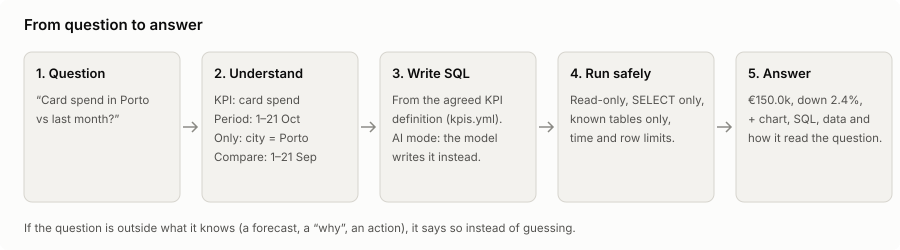
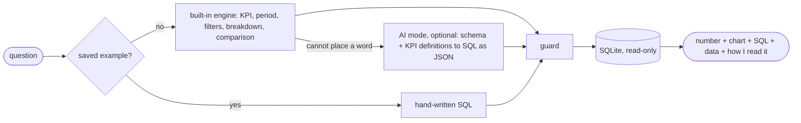

# Architecture

## The flow

1. **Understand.** The built-in engine (`engine.py`, `timeparse.py`) reads the KPI, the period, filters, the
   breakdown and the comparison, using the names and synonyms in `kpis.yml`. Follow-ups ("and in Faro?") reuse
   the last reading.
2. **Write SQL.** The SQL comes from the KPI's definition, never from free text. When the engine cannot place a
   word, it says so instead of guessing.
3. **AI mode (optional).** With a key, the model gets the schema and the KPI definitions and replies with SQL as
   JSON. If the SQL fails, the error goes back to it, up to 2 retries. Tokens and the euro estimate are shown under
   the answer.
4. **Guard.** Every query, from any source, runs through `guard.py` (below).
5. **Answer.** The number in plain English, a chart, the SQL, the data and *how I read it*, so anyone can check it.

## The semantic layer: `kpis.yml`

30 metrics and 10 dimensions, each defined once: where it lives, the SQL expression, an always-on filter and the
unit. Both engines use the same definitions, so the same question gives the same number however it is asked.

## Safety layers (`guard.py`)

| Layer | What it stops |
|---|---|
| The text must be one `SELECT` (or `WITH ... SELECT`) | several statements, writes |
| Read-only connection with `PRAGMA query_only` | any write that slips through |
| SQLite authorizer: the 7 bank tables only | `PRAGMA`, `ATTACH`, other tables, `load_extension` and file functions |
| Time limit (8 s) and row limit (2,000) | runaway queries |

## Alerts (`alerts.py`)

For each branch, card payments, ATM withdrawals and transfers out are compared with the same weekday and hours of
the last four weeks. Counts are flagged only when at least 40% away from usual and very unlikely under a Poisson
model; money only when at least double or half, 4+ standard deviations of the normal swing and at least EUR 100k
away.

## AI costs

`costs.py` holds an editable price table and the EUR conversion; `usage.py` keeps a ledger in the browser's local
storage with a monthly budget (warning at 80%, AI paused at 100%). Prompt caching sends the fixed instructions at
about a tenth of the price on repeat calls. API keys are never stored.

## Where it runs

| Piece | Local | Public demo |
|---|---|---|
| App | `streamlit run app.py` | Streamlit Cloud |
| Database | SQLite, simulated on first start, new payments added as time passes | the same, rebuilt on restart |
| AI mode | your key: Anthropic, OpenAI, or an OpenAI-compatible server such as Ollama | your key, or the no-key Demo that only estimates tokens |
| Tests | `python -m unittest -v`, `python evaluate.py` | GitHub Actions on every push |

For a real bank, the SQLite file becomes a read-only warehouse role (the guard's checks stay the same), and
`kpis.yml` is owned by the finance or data team.

More: [data card](data_card.md) · [evaluation](evaluation.md) · [decision records](adr/)
